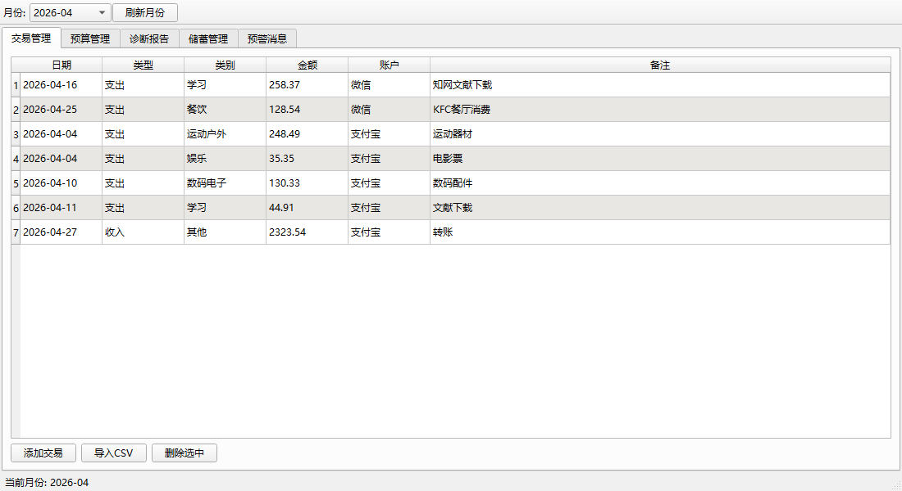

# Desktop Expense Tracker

[中文](README.md) | [English](README.en.md)

A PySide6 desktop expense tracker built for an object-oriented programming course project. It records income and expenses, imports WeChat Pay and Alipay bill CSV files, manages budgets, and produces spending assessments and savings plans.

The code is organized into several directories: `models/` holds data classes, `services/` holds business logic, and `strategies/`, `rules/`, and `methods/` each contain a family of strategies. Each family has an abstract base class and several implementations. `FinanceController` holds references to the base classes so implementations can be swapped without changing the calling code.

## Screenshot



## Features

### Transaction management

Record income and expenses with an amount, transaction type, category, payment account, date, and note. Accounts include WeChat Pay, Alipay, and bank cards. Filter the list by month, type, category, or account.

Bill import supports WeChat Pay bills and Alipay transaction records in their respective exported formats. The program identifies the source from the start of the file and parses the corresponding column layout. If a row cannot be parsed, it skips only that row and prints its line number; the rest of the import continues.

Data is saved as JSON and loaded at the next launch.

### Budget management

Set monthly limits by category. The table shows spending to date, remaining funds, and whether a category is over budget. Entering an expense triggers a warning if its category exceeds the limit. Two allocation rules are available: fixed budgets and 50/30/20.

### Spending assessment

There are five assessment strategies: savings rate, category overspending, spending mix, savings goals, and a weighted combination of the other strategies. The default is the combined strategy, which scores the first three dimensions:

| Dimension | Calculation |
| --- | --- |
| Savings rate | (Total income − total expenses) / total income; points are deducted below the threshold |
| Category overspending | Iterate over budget categories and calculate how far each exceeds its limit |
| Spending mix | Compare the shares of basic meals, social dining, entertainment, and education with configured healthy ranges |

The result is a report with a rating (healthy / warning / serious), scores for each dimension, and recommendations in priority order.

### Savings management

Plan backward from a savings target: enter an amount and a number of months, and the program uses historical income and expenses to calculate the required monthly savings. It allocates the gap proportionally across spending categories.

Three savings methods are available: a fixed amount, the 52-week savings challenge, and a share of income. The 52-week method has a switch between increasing (save N × the base amount in week N) and decreasing contributions.

## Requirements

Python 3.10 or later. The type annotations in `services/finance_controller.py` use `str | None`, which requires Python 3.10; the project does not use `from __future__ import annotations` as a fallback.

PySide6 6.5 or later. There are no other third-party dependencies.

## Install and run

```bash
git clone https://github.com/DubheTony/oop-proj-account-book.git
cd oop-proj-account-book

python -m venv .venv
.venv\Scripts\activate        # Windows
# source .venv/bin/activate   # macOS / Linux

pip install -r requirements.txt
python main_gui.py
```

The first time you add a transaction or change a setting, the program creates `transactions.json` and `app_settings.json` in the project root. These files contain only your own data and are excluded from commits by `.gitignore`.

### Try importing sample bills

The two CSV files in `sample_data/` follow the formats of real exports but contain generated, fictional data. Alipay may export an XLSX file; these examples appear to have been saved as CSV at the time:

```text
sample_data/微信支付账单_示例.csv
sample_data/支付宝交易明细_示例.csv
```

In the transaction page, click “导入CSV” (Import CSV) and choose either file. Together, the files import 116 records, skip none, and automatically classify transactions by merchant name.

## Directory structure

```text
oop-proj-account-book/
├── main_gui.py                  # Application entry point; main window and four pages of business logic
├── main_gui.ui                  # Qt Designer UI file
├── add_transaction_dialog.ui
├── set_budget_dialog.ui
├── ui_main_gui.py               # Python class generated from .ui by pyside6-uic
├── ui_add_transaction_dialog.py
├── ui_set_budget_dialog.py
├── requirements.txt             # Only dependency: PySide6
├── models/                      # Data classes such as Transaction, Budget, and Suggestion
├── services/                    # FinanceController, CSV parsing, categorization rules, savings calculations
├── strategies/                  # Assessment strategy family
├── rules/                       # Budget rule family
├── methods/                     # Savings method family
├── sample_data/                 # Sample bills
├── docs/                        # Design docs, interface docs, UML diagram
├── .github/workflows/           # Workflow for automatically passing PR checks
└── .gitignore
```

### Regenerate code after changing the interface

Edit the `.ui` files in Qt Designer, then regenerate the Python files:

```bash
pyside6-uic main_gui.ui                -o ui_main_gui.py
pyside6-uic add_transaction_dialog.ui  -o ui_add_transaction_dialog.py
pyside6-uic set_budget_dialog.ui       -o ui_set_budget_dialog.py
```

## Documentation

| File | Contents |
| --- | --- |
| [设计文档.md](docs/设计文档.md) | Overall design, modules, and responsibilities |
| [接口文档.md](docs/接口文档.md) | Class and method signatures |
| [架构构思-CSV导入模块.md](docs/架构构思-CSV导入模块.md) | CSV import format-adapter design |
| [功能说明.md](docs/功能说明.md) | Feature list and implementation scope |
| [项目描述.md](docs/项目描述.md) | Project purpose and distinguishing features |
| [知识点梳理.md](docs/知识点梳理.md) | Object-oriented concepts used in the project |
| [题目.md](docs/题目.md) | Original course assignment |
| [UML类图展示.html](docs/UML类图展示.html) | UML diagram; open in a browser |

## Implementation choices

All three strategy families use an abstract base class with several subclasses; `FinanceController` keeps references to their base classes. There are five assessment implementations, two budget rules, and three savings methods.

Merchant-to-category mappings are stored in `services/category_rules.json`, rather than in Python code. Add a mapping without changing the Python files.

CSV imports tolerate individual row errors: a row that cannot be parsed is skipped with its line number printed, without aborting the rest of the import.

## Data

The sample bills in the repository are generated and fictional; they contain no real personal information and are only for testing the import feature. Do not commit real bills to this repository.

## License

Original source code and documentation in this repository are under the [MIT License](LICENSE).
